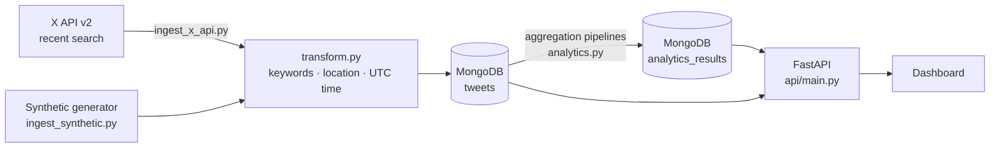

# SENAPRED Emergency Tweet Pipeline


A data pipeline that collects emergency-related tweets about Chile (earthquakes, fires, tsunamis, floods…), stores them in MongoDB, computes analytics by **location, keyword and hour**, and serves them through a **FastAPI** service for a monitoring dashboard.

> Academic team project (ESILV PI²) for **SENAPRED**, Chile's National Disaster Prevention and Response Service. This repository contains the data ingestion, analytics and API layer.

## Why

During an emergency, people post on social media before official reports arrive. Counting where and when emergency words spike gives responders an early, low-cost signal of which regions need attention.

## Architecture



| Step | What it does |
|---|---|
| **Ingest** | `ingest_x_api.py` polls the X API recent-search endpoint, uses `since_id` to fetch only new tweets and backs off on rate limits. `ingest_synthetic.py` produces realistic test tweets, because the free X API tier allows very few requests. |
| **Transform** | `transform.py` normalises text (accents, case), detects emergency keywords and Chilean cities, and converts timestamps to UTC. Pure functions, fully unit-tested. |
| **Load** | Bulk upserts keyed on a unique `tweet_id` index: re-running ingestion never creates duplicates. |
| **Analytics** | `analytics.py` counts tweets by location, keyword, hour and source with MongoDB aggregation pipelines, so the work runs inside the database instead of loading everything into Python. |
| **Serve** | `api/main.py` exposes the results; read endpoints are `GET`, the recompute endpoint is `POST`. |

## Quick start (Docker)

```bash
git clone https://github.com/govindabhattarai03/senapred-twitter-stream.git
cd senapred-twitter-stream
docker compose up --build        # MongoDB + API + synthetic tweet generator
```

Then open **http://localhost:8000/docs**, run `POST /analytics/run`, and query the results.

To ingest **live tweets** instead, copy `.env.example` to `.env`, add your X API bearer token, and run:

```bash
docker compose --profile live up --build
```

## Run locally without Docker

```bash
python -m venv .venv && source .venv/bin/activate
pip install -r requirements.txt
cp .env.example .env                              # MongoDB must be running on localhost:27017

python -m pipeline.ingest_synthetic --count 500   # back-fill 500 tweets over the last 24h
python -m pipeline.analytics                      # compute and print analytics
uvicorn api.main:app --reload                     # http://localhost:8000/docs
```

## API

| Method | Endpoint | Returns |
|---|---|---|
| GET | `/health` | Service and database status |
| GET | `/tweets/latest?limit=20&keyword=sismo` | Most recent tweets, optionally filtered by keyword |
| GET | `/analytics/latest` | Latest full analytics snapshot |
| GET | `/analytics/locations` | Tweet counts per city |
| GET | `/analytics/keywords` | Tweet counts per emergency keyword |
| GET | `/analytics/hours` | Tweet counts per hour |
| POST | `/analytics/run?window_hours=24` | Recomputes analytics over the last N hours |

## Example output

`python -m pipeline.analytics` on 500 synthetic tweets (hourly counts truncated):

```json
{
  "window_hours": 24,
  "total_tweets": 500,
  "counts_by_location": { "Iquique": 66, "Concepción": 65, "Temuco": 65, "Puerto Montt": 64, "...": "..." },
  "counts_by_keyword": { "terremoto": 77, "incendio": 74, "alerta": 69, "tsunami": 63, "...": "..." },
  "counts_by_hour": { "2026-10-18 14:00": 26, "2026-10-18 15:00": 21, "...": "..." },
  "counts_by_source": { "synthetic": 500 }
}
```

Stored tweet document:

```json
{
  "tweet_id": "208524553037123627",
  "text": "Reporte de incendio en Puerto Montt.",
  "lang": "es",
  "created_at": "2026-10-19T02:10:59Z",
  "location": "Puerto Montt",
  "keywords": ["incendio"],
  "public_metrics": { "like_count": 298, "retweet_count": 14, "reply_count": 32 },
  "source": "synthetic"
}
```

## Tests

```bash
pytest -q
```

Unit tests cover the transformations; end-to-end tests run ingestion → analytics → API against an in-memory MongoDB (mongomock). They run automatically on every push with GitHub Actions.

## Project structure

```
pipeline/
  config.py            settings from environment variables (.env)
  transform.py         text normalisation, keyword & location extraction
  db.py                MongoDB client, indexes, bulk upserts
  ingest_x_api.py      live ingestion from the X API
  ingest_synthetic.py  synthetic tweet generator / back-fill
  analytics.py         aggregation pipelines
api/main.py            FastAPI service
tests/                 unit and end-to-end tests
```

## Limitations and next steps

- Keyword matching is rule-based. Next step: a Spanish sentiment or emergency classifier (e.g. a fine-tuned BERT model) to reduce false positives such as "alerta" used figuratively.
- Most real tweets have no geotag, so location relies on city names in the text.
- Analytics are recomputed on demand. Next step: schedule them with an orchestrator (Airflow or Prefect) and keep historical snapshots.
- MongoDB fits the semi-structured tweet data; for heavy historical analysis, tweets could be exported to a warehouse such as BigQuery.

## Tech stack

Python · MongoDB · FastAPI · Docker Compose · pytest · GitHub Actions
